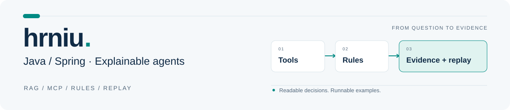

<picture>
  <source media="(prefers-color-scheme: dark)" srcset="./assets/github-studio/hero-dark.svg" />
  
</picture>

我是 **hrniu（@hrniux）**，做 Java / Spring 后端与可解释智能体实践：把模型建议接到规则、证据和可重演的流程里。也做浏览器小游戏，整理开发工作流和数学笔记。

[核心项目](#核心项目) · [实践入口](#实践入口) · [其他作品](#其他作品)

## 核心项目

### insurance-underwriting-agent · 可解释核保

Java 21 / Spring Boot 4.1 / Spring AI 2.0 的离线核保 Demo，把 RAG、MCP 工具、确定性规则、审计、人工复核与决策重演串成可检查的链路。

[源码](https://github.com/hrniux/insurance-underwriting-agent) · [运行指南](https://github.com/hrniux/insurance-underwriting-agent#快速启动) · [场景与学习文档](https://github.com/hrniux/insurance-underwriting-agent/blob/main/docs/DEMO_DATA_GUIDE.md)

### spring-boot-lab · 后端实验

从 Task REST API 入手，练习参数校验、ProblemDetail 错误响应、内存仓储与 MockMvc 测试，保留小而完整的 Spring Boot 示例。

[源码](https://github.com/hrniux/spring-boot-lab) · [运行指南](https://github.com/hrniux/spring-boot-lab#运行) · [内容与接口](https://github.com/hrniux/spring-boot-lab#内容)

### codex-skills · 开发工作流

把聚焦解决问题、GitHub HTTPS 本地认证和 Obsidian 本地知识库维护整理成可复用的 Codex skills。

[源码](https://github.com/hrniux/codex-skills) · [安装与使用](https://github.com/hrniux/codex-skills#installation) · [技能文档](https://github.com/hrniux/codex-skills/tree/main/skills)

## 实践入口

**先跑通，再读实现。** 核保项目的 `main` 默认使用离线 Mock，无需 API Key 或外部数据库。本机准备完整 JDK 21+，从下面的命令开始：

```bash
git clone https://github.com/hrniux/insurance-underwriting-agent.git
cd insurance-underwriting-agent
./mvnw clean verify
./mvnw spring-boot:run
```

启动后打开 <http://localhost:8080/demo/>，运行虚构场景，查看规则、证据、人工复核与决策重演。

[可复现验收工具（Draft PR #2）](https://github.com/hrniux/insurance-underwriting-agent/pull/2)：补充 `bash scripts/run-verified-demo.sh` 验收入口；**仍未合并，脚本仅在 PR 分支中**。

## 其他作品

| 项目 | 做什么 | 入口 |
| --- | --- | --- |
| [browser-game-arcade](https://github.com/hrniux/browser-game-arcade) | 原生 JavaScript 小游戏与互动实验合集 | [在线体验](https://hrniux.github.io/browser-game-arcade/) |
| [harvest-valley-lite](https://github.com/hrniux/harvest-valley-lite) | Canvas 农场小游戏：播种、浇水、收获与升级 | [本地运行](https://github.com/hrniux/harvest-valley-lite#play) |
| [math-conjectures](https://github.com/hrniux/math-conjectures) | 数学猜想的精确陈述、通俗解释与进展笔记 | [按领域阅读](https://github.com/hrniux/math-conjectures#按领域浏览) |
| [verify-authenticity](https://github.com/hrniux/verify-authenticity) | 用可重复实验说明 Git 提交姓名与源码署名的证据边界 | [运行实验](https://github.com/hrniux/verify-authenticity#一键运行) |

<sub>[GitHub Studio｜规划与脚本](https://github.com/hrniux/hrniux/tree/github-studio)</sub>
